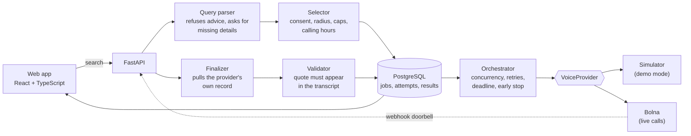

<div align="center">

# Sonar

### Search the real world by calling it.

A voice-agent search engine for facts that live only in the heads of people at real businesses.
It phones shops that agreed to be called, asks one factual question, checks the answer against the
call transcript, and shows what each shop said, with the evidence and the time.


[The problem](#the-problem) ·
[Status](#status) ·
[A real call](#a-real-test-call) ·
[Principles](#principles) ·
[How it works](#how-it-works) ·
[Quick start](#quick-start) ·
[Roadmap](docs/IMPROVEMENTS.md)

</div>

---

Sonar **reports; it does not guarantee.** An answer is what a business said on a call. A shop that
did not pick up, failed, hedged, declined or was skipped is never shown as "unavailable".

Built for the Bolna Buildathon (Symphony 2026).

## The problem

Maps and search engines list a shop's address and opening hours, but not its stock. Many small
businesses, such as pharmacies, repair shops and hardware stores, have no online inventory at all.
To learn whether a nearby shop has an item right now, you have to phone it, or go and find out. When
the item is a medicine, a wasted trip matters.

Sonar does the phoning: a few nearby shops that agreed to be called are asked one short question by an
automated assistant that says it is an AI, and you see what each one answered.

## Status

| Area | State |
|---|---|
| Core pipeline (search, consent-gated calling, validation, results) | Working. Tested on a simulator, a mocked Bolna API and a real database |
| Web application | Working, with live progress, evidence, map and radar views |
| Real calls through Bolna | **Exercised in a handful of test calls** to team phones (2026-10-25). Response fields and extraction shape captured and the parser fixed. The webhook path has not been run live |
| Answer accuracy, pickup rate, cost per call | **Not yet measured** (four test calls are not a sample) |
| Real shops, consent flow with real businesses, legal review | **Not started** |

Nothing in this repository claims a result that has not been measured. See
[`docs/LIMITATIONS.md`](docs/LIMITATIONS.md) for exactly what is and is not proven, and
[`docs/FEASIBILITY.md`](docs/FEASIBILITY.md) for what the first live calls showed.

## A real test call

One of the first live calls, to a team phone playing a shopkeeper. The agent opens with the AI
disclosure, then asks.

```text
assistant: Hello, this is an automated assistant calling for Sonar. I'm checking a quick fact for a
           customer. Is now an okay moment for one or two questions? This call is transcribed to
           record your answer.
user:      yes
assistant: Do you currently have Paracetamol strength 500 mg available?
user:      yes
assistant: Just to be sure, is that exactly Paracetamol strength 500 mg?
user:      yes
assistant: Could you tell me the price for that one?
user:      twenty rupees
```

What Sonar stored from it: availability *available*, exact match *yes*, price *20*, supporting
quote taken from the shop's own words. A different call, in which the speech-to-text mangled a unit,
was recorded as *not an exact match* rather than guessed, which is the behaviour we want: when in
doubt, Sonar says less.

## Principles

1. **Consent first.** No business is called without a recorded yes. Consent is re-checked immediately
   before every dial, and an opt-out is permanent.
2. **Silence is never "no".** Wording for unanswered, failed, declined, uncertain and skipped calls is
   tested to never claim unavailability.
3. **Never trust a webhook.** A webhook only signals that something happened. Sonar pulls the
   provider's own record before writing any result.
4. **Evidence or nothing.** A "yes" is accepted only if the shop's own words in the transcript support
   it. Prices must have been spoken. Unknown stays unknown.
5. **Honest about simulation.** Simulated results carry a permanent banner and a per-result tag, and
   can never be mistaken for live data.
6. **Duplicate calls are worse than missed ones.** If a dispatch might have reached the provider, the
   outcome is "unknown" and Sonar never redials automatically.

## Features

- **Structured search** with clarifying questions instead of guesses, and refusal of advice-style
  queries (dosage, interactions, prescription-only items).
- **Bounded, auditable calling:** nearest consenting shops first, with per-shop daily caps, cooldowns,
  calling hours, a daily call budget, a search deadline, and at most two concurrent calls.
- **Early stop:** once two different shops have confirmed, remaining calls are skipped and shown as
  "Not called". "Ask every shop" turns this off. Shop call history informs the order.
- **Answer validator:** deterministic rules over the call transcript. Free-form model output is never
  shown to users.
- **Live interface:** progress per call, ranked results, expandable evidence, a map
  ([OpenStreetMap](https://www.openstreetmap.org/copyright)) or an offline radar, a "what Sonar chose
  not to claim" panel, and optional read-aloud.
- **Shop digest** (behind a flag): a private page showing a consenting shop what people near it
  searched for, with counts suppressed below a minimum and an opt-out button.
- **Measurement tooling:** metrics with denominators, independent ground-truth checks, human review,
  and retention and deletion tools.

## How it works



1. **Search.** The form sends a structured query. Missing details become questions; advice-style
   queries are refused.
2. **Plan.** Up to five consenting shops in range are chosen and ordered. A live search is refused up
   front if live calling is not configured.
3. **Call.** A background worker dials. Provider errors are classified so that anything uncertain is
   never retried.
4. **Finalize.** The webhook triggers a pull of the provider's execution record. A lost webhook is
   recovered by a reconciler.
5. **Validate.** The validator turns the record into a stored result: available, unavailable,
   alternative only, uncertain or declined, with the supporting quote.
6. **Show.** The page polls and renders progress and results as they arrive.

## Quick start

**Prerequisites:** Python 3.11+, Node 22+, Docker with Compose, Git.

```powershell
copy .env.example .env             # then set SONAR_ACCESS_KEY to any long random value
.\tasks.ps1 setup                  # Python virtual environment and dependencies
.\tasks.ps1 db-up                  # PostgreSQL on localhost:55432
cd backend; .\.venv\Scripts\alembic upgrade head; cd ..
backend\.venv\Scripts\python scripts\seed_businesses.py data\businesses.example.yaml
npm --prefix frontend install
```

Run the API and the web app in two terminals:

```powershell
backend\.venv\Scripts\python -m uvicorn app.main:app --app-dir backend --port 8000
npm --prefix frontend run dev
```

Open <http://localhost:5173>, enter your access key, and search. **Demo mode is on by default**:
nobody is phoned and every result is marked simulated.

On macOS or Linux, use the `Makefile` targets in place of `tasks.ps1`.

### Enabling live calls

Live calling needs a Bolna API key and a configured voice agent, and is off otherwise. Follow
[`spikes/bolna/README.md`](spikes/bolna/README.md) before calling anyone. The agent prompt and the
extraction fields to create in the dashboard are in [`docs/agent/prompt_v1.md`](docs/agent/prompt_v1.md).
Never call a business before consent is recorded ([`docs/CONSENT_SCRIPT.md`](docs/CONSENT_SCRIPT.md)).

## Configuration

Settings are read from environment variables (or `.env`). `.env.example` lists them all; the ones
that matter most:

| Variable | Purpose | Default |
|---|---|---|
| `SONAR_ENV` | `dev` or `prod` | `dev` |
| `DATABASE_URL` | PostgreSQL connection string | local compose database |
| `SONAR_ACCESS_KEY` | Shared key sent as `X-Sonar-Key` to start a search | none (refuses if unset) |
| `WEBHOOK_SECRET_TOKEN` | Path token for the provider webhook | none (refuses if unset) |
| `BOLNA_API_KEY`, `BOLNA_AGENT_ID_<CATEGORY>` | Enable live calling, one agent per category | unset (demo mode only) |
| `MAX_TARGETS_PER_SEARCH` | Shops planned per search | 5 |
| `MAX_CONCURRENT_CALLS` | Simultaneous calls | 2 |
| `GLOBAL_DAILY_CALL_BUDGET` | Live calls per day before dispatch stops | 40 |
| `BUSINESS_DAILY_CALL_CAP`, `BUSINESS_COOLDOWN_MINUTES` | Per-shop limits | 4 per day, 15 minutes |
| `SEARCH_DEADLINE_SECONDS` | Unfinished calls time out after this | 300 |
| `FEATURE_STOP_RULE`, `FEATURE_HISTORY`, `FEATURE_DIGEST` | Optional features | off |
| `FEATURE_CACHE_REUSE` | Show a shop's fresh earlier live answer to the same question instead of calling again (labelled "Earlier call") | off |
| `FEATURE_LIVE_TICKER` | Show the last lines of calls in progress, for team test lines and simulated calls only | off |
| `FRONTEND_DIST` | Serve the built web app from the API | unset |
| `VITE_TILE_URL` | Map tile server (public, no secrets) | OpenStreetMap |

With every optional feature off, Sonar behaves as the baseline product.

## API

| Method | Path | Purpose |
|---|---|---|
| `POST` | `/api/searches` | Plan a search (requires `X-Sonar-Key`) |
| `GET` | `/api/searches/{id}` | Progress, per-call status and counts |
| `GET` | `/api/searches/{id}/results` | Ranked results with evidence |
| `POST` | `/api/searches/{id}/cancel` | Stop further calls |
| `GET` | `/api/businesses` | Eligible businesses (never includes phone numbers) |
| `GET` | `/api/config/public` | Non-secret configuration for the UI |
| `POST` | `/api/webhooks/bolna/{token}` | Provider webhook receiver |
| `GET` | `/health`, `/health/ready` | Liveness and readiness |

Errors use one envelope: `{"error": {"code", "message", "field", "request_id"}}`. Interactive
documentation is served at `/docs` while the API runs.

## Project layout

```
backend/
  app/
    api/         HTTP routes, errors, auth, rate limiting
    domain/      enums, schemas, call-state rules
    db/          models, repositories
    providers/   VoiceProvider interface, Bolna client, simulator
    services/    query parser, selector, orchestrator, finalizer, validator, metrics
  alembic/       database migrations
  tests/         unit and integration tests
frontend/        React + TypeScript web app (Vite, Tailwind, Leaflet)
scripts/         seed, metrics, review, retention, deployment and secret checks
spikes/bolna/    throwaway tools for the Bolna feasibility spike
config/          category and blocked-term configuration (data, not code)
docs/            operations, limitations, demo, business case, consent, submission
```

## Testing

```powershell
.\tasks.ps1 check          # lint, backend unit tests, secret scan, claims scan
.\tasks.ps1 test-int       # database tests (needs db-up)
npm --prefix frontend test # frontend tests
.\tasks.ps1 check-bundle   # builds the web app and scans it for leaked secrets
```

The suite includes tests for the safety rules themselves: consent re-checked before dialing, no
double dial after a crash, forged or duplicated webhooks ignored, and silence never worded as
unavailability. Database tests run against real PostgreSQL.

## Deployment

A single image serves the API and the built web app:

```powershell
docker build -f backend/Dockerfile -t sonar .
```

`docker-compose.prod.example.yml` shows a production-style stack: migrations as a separate release
step, no published database port, and real shop data mounted read-only. Run
`python scripts/check_prod_env.py --env-file .env.prod` before every deployment; it refuses weak or
default secrets. See [`docs/OPERATIONS.md`](docs/OPERATIONS.md).

## Privacy and data handling

- Phone numbers are masked in logs and never returned by any public endpoint.
- Real shop data lives in a git-ignored file and is mounted into the container, never baked into it.
- Raw provider events are deleted after 30 days and call excerpts are cleared after 90, automatically.
- A shop's data can be deleted on request while its opt-out is kept
  (`scripts/delete_business_data.py`).
- Audio is neither downloaded nor stored by Sonar.
- The map contacts OpenStreetMap's tile servers; the radar view contacts nothing.

## Documentation

| Document | Contents |
|---|---|
| [`docs/LIMITATIONS.md`](docs/LIMITATIONS.md) | What is proven, what is not, and deliberate limits |
| [`docs/OPERATIONS.md`](docs/OPERATIONS.md) | Running, rolling back, opt-outs, cost |
| [`docs/DEMO_SCRIPT.md`](docs/DEMO_SCRIPT.md) | The three-minute demo and what never to say |
| [`docs/BUSINESS_CASE.md`](docs/BUSINESS_CASE.md) | Hypotheses with pre-set pass and kill rules |
| [`docs/CONSENT_SCRIPT.md`](docs/CONSENT_SCRIPT.md) | How to ask a business for permission |
| [`docs/FEASIBILITY.md`](docs/FEASIBILITY.md) | The Bolna spike record and first live-call findings |
| [`docs/IMPROVEMENTS.md`](docs/IMPROVEMENTS.md) | Scaling and improvement plan: agent, languages, map, UI, reliability, legal |
| [`docs/METRICS.md`](docs/METRICS.md) | Measured results |
| [`docs/SUBMISSION.md`](docs/SUBMISSION.md) | Submission checklist |
| [`SONAR_BIBLE_v2.md`](SONAR_BIBLE_v2.md), [`SONAR_BUILD_MAP_v2.md`](SONAR_BUILD_MAP_v2.md) | Specification, decision log and execution plan |

## Contributing

See [`docs/WORKFLOW.md`](docs/WORKFLOW.md) for commit and testing conventions. Do not commit `.env`,
real phone numbers, real transcripts or raw provider captures; `scripts/check_no_secrets.py` is the
safety net.

## Licence

Not yet chosen.

## Acknowledgements

Voice technology by [Bolna](https://www.bolna.ai). Map data © [OpenStreetMap](https://www.openstreetmap.org/copyright)
contributors.
