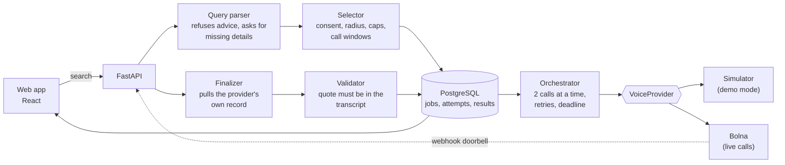

# Sonar

**Search the real world by calling it.** Sonar phones a small set of *consenting* businesses with an
honest, automated voice agent, asks one short factual question ("do you have this in stock right
now?"), validates what each said, and shows the answers with their evidence and timestamps.

It reports; it does not guarantee. A shop that did not answer, failed, hedged or was skipped is
**never** shown as "unavailable".

> **Build state in one line:** the full pipeline works end to end on a simulator and against a
> mocked Bolna API, with a web interface. **No real call has been placed yet** (waiting on the Bolna
> API key). See [`docs/LIMITATIONS.md`](docs/LIMITATIONS.md) for exactly what is and is not proven.

## How it works



1. **Search.** The form sends a structured query. Advice-style questions are refused; missing
   details become questions, never guesses.
2. **Plan.** Up to 5 consenting shops in range are chosen, nearest first, respecting each shop's
   daily cap, cooldown and calling hours. A live search is refused up front if live calling is not
   configured.
3. **Call.** A background worker dials at most 2 at a time. Consent is re-checked right before every
   dial. An uncertain dispatch is never redialed.
4. **Finalize.** A webhook only rings a doorbell. Sonar pulls the provider's own record, so a forged
   or duplicated webhook cannot write a result.
5. **Validate.** A "yes" needs a quote that really appears in the transcript, an exact-match
   confirmation, and a spoken price. Otherwise the answer is shown as Uncertain.
6. **Stop early.** Once two different shops have confirmed, remaining calls are skipped and shown
   as "Not called". "Ask every shop" turns that off.
7. **Show.** Ranked answers, an evidence panel, a radar view, a "what Sonar chose not to claim"
   list, and an optional read-aloud.

## Run it locally (Windows)

Prerequisites: Python 3.11+, Node 22+, Docker with Compose, Git.

```powershell
copy .env.example .env          # then edit: set SONAR_ACCESS_KEY to any long random value
.\tasks.ps1 setup               # Python venv and dependencies
.\tasks.ps1 db-up               # PostgreSQL on localhost:55432
cd backend; .\.venv\Scripts\alembic upgrade head; cd ..
backend\.venv\Scripts\python scripts\seed_businesses.py data\businesses.example.yaml
npm --prefix frontend install
```

Then, in two terminals:

```powershell
backend\.venv\Scripts\python -m uvicorn app.main:app --app-dir backend --port 8000
npm --prefix frontend run dev
```

Open http://localhost:5173, type your access key, and search. **Demo mode is on by default**: nobody
is phoned, and every result is marked SIMULATED.

On macOS or Linux use the `Makefile` targets in place of `tasks.ps1`.

### Going live (needs a Bolna key)

Set `BOLNA_API_KEY` and `BOLNA_AGENT_ID_PHARMACY` in `.env`, create the agent from
[`docs/agent/prompt_v1.md`](docs/agent/prompt_v1.md), expose `/api/webhooks/bolna/<token>` over public
HTTPS, and follow [`spikes/bolna/README.md`](spikes/bolna/README.md) **before** any real shop is
called. No real business is called without a recorded consent
([`docs/CONSENT_SCRIPT.md`](docs/CONSENT_SCRIPT.md)).

## Checks

```powershell
.\tasks.ps1 check          # lint, backend unit tests, secret scan, claims scan
.\tasks.ps1 test-int       # database tests (needs db-up)
npm --prefix frontend test
.\tasks.ps1 check-bundle   # builds the web app and scans it for secrets
```

## Deploy

One image serves the API and the web app: `docker build -f backend/Dockerfile -t sonar .`.
See [`docs/OPERATIONS.md`](docs/OPERATIONS.md) and `docker-compose.prod.example.yml`. Run
`scripts/check_prod_env.py` before every deployment.

## Documents

| | |
|---|---|
| [`SONAR_BIBLE_v2.md`](SONAR_BIBLE_v2.md), [`SONAR_BUILD_MAP_v2.md`](SONAR_BUILD_MAP_v2.md) | The specification and the execution plan |
| [`docs/LIMITATIONS.md`](docs/LIMITATIONS.md) | What is proven, what is not, and what is deliberately limited |
| [`docs/DEMO_SCRIPT.md`](docs/DEMO_SCRIPT.md) | The 3-minute demo, pre-flight list, and what never to say |
| [`docs/BUSINESS_CASE.md`](docs/BUSINESS_CASE.md) | Hypotheses with pre-set pass and kill rules (none tested yet) |
| [`docs/CONSENT_SCRIPT.md`](docs/CONSENT_SCRIPT.md) | How to ask a shop for permission |
| [`docs/OPERATIONS.md`](docs/OPERATIONS.md) | Running, rolling back, opt-outs, cost |
| [`docs/SUBMISSION.md`](docs/SUBMISSION.md) | Submission checklist and application text |
| [`docs/FEASIBILITY.md`](docs/FEASIBILITY.md) | The Bolna spike record (blank until the key arrives) |
| [`docs/METRICS.md`](docs/METRICS.md) | Measured numbers (none yet) |

## Principles

Never fabricate availability. Never confuse silence with "no". Never present simulated data as
live. Never call a business without recorded consent. Every claim in the pitch maps to something
the screen shows or a measurement we made.
